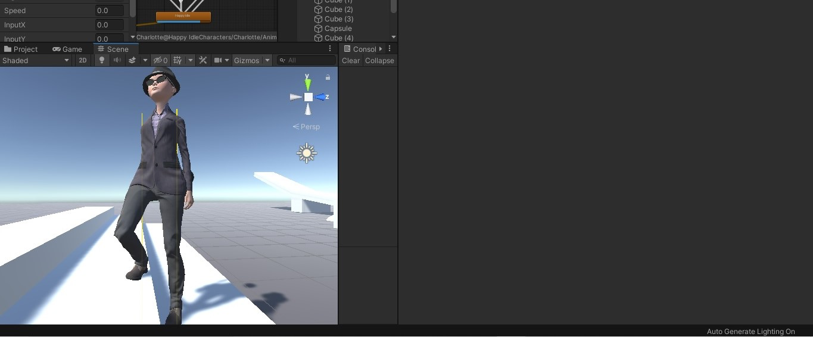
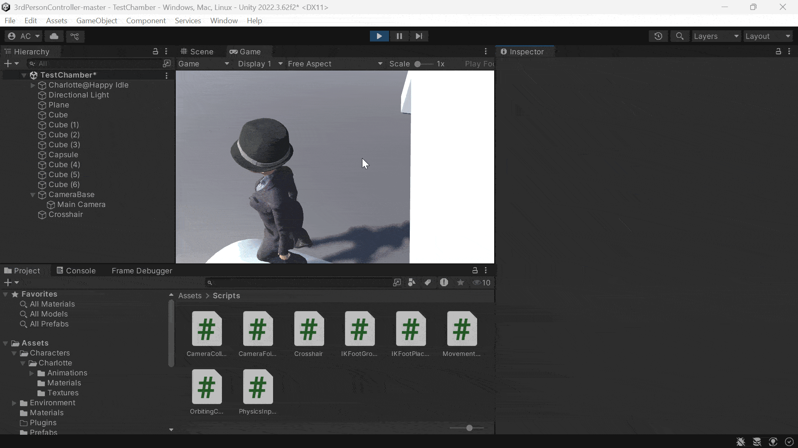

 

# 3rdPersonController
A 3rd Person Character Controller made in Unity3D

## Contents

- [About](#about)
- [Features](#features)
- [Demo](#demo)

## About
- A prototype for a 3rd person game character controller using animations and models from mixamo.com.

## Features
- Inverse Kinematics for foot placement
- Basic Animation Controller Setup
- Strafe Animation
- Orbital Camera Controller
